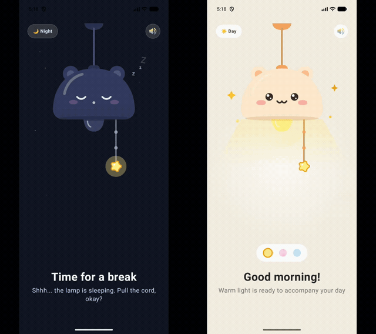

# 🪔 MochiLamp

Lampu tarik kawaii interaktif, dibangun murni dengan **Jetpack Compose 1.13** dan **Material 3 Expressive** — tanpa library grafis pihak ketiga. Tarik talinya, nyalakan lampu, dan lihat si Mochi Lamp bereaksi dengan ekspresi wajahnya sendiri.



## ✨ Fitur

- **5 ekspresi wajah dinamis** — `Sleepy`, `Dragging`, `Threshold`, `Happy`, `Blush` yang berubah real-time sesuai interaksi
- **Tali elastis & fisika pegas** — tarikan tali memakai kurva Bezier kuadratik dengan redaman karet (*rubber-band damping*) dan haptic feedback saat melewati threshold
- **Ayunan bandul & squash-and-stretch** — badan lampu berayun dan berdeformasi secara elastis layaknya objek fisik
- **Easter egg** — ketuk badan lampu untuk memicu ekspresi blush dan partikel hati yang melayang
- **3 nuansa cahaya**: `Warm`, `Sakura`, `Sky` — dipilih lewat picker kapsul Material 3
- **Eye tracking & auto blink** — mata mengikuti posisi sentuhan dan berkedip otomatis
- **Efek cahaya & glow** — radial light burst dan warm aura glow di sekitar kap lampu saat menyala

## 🛠️ Tech Stack

- Kotlin 2.2+
- Jetpack Compose 1.13.0 (BOM `2026.11.01`)
- Material 3 1.5.0
- `compileSdk 37`, `minSdk 26`

## 🚀 Menjalankan Proyek

```bash
git clone <repo-url>
cd MochiLamp
./gradlew installDebug
```

Atau buka folder ini di **Android Studio** dan jalankan langsung dari modul `app`.

## 📁 Struktur Proyek

```
app/src/main/java/com/veroanggra/mochilamp/
├── audio/            # Sintesis suara prosedural (klik, switch, dsb.)
├── model/            # State lampu, ekspresi wajah, nuansa warna
├── ui/lamp/          # Layar utama & komponen kanvas lampu
└── ui/theme/         # Tema Material 3
```
